# AsisGo

**Control de asistencia corporativo con geolocalización, hecho en Flutter.**

AsisGo permite a los colaboradores registrar su jornada (entrada, refrigerio y salida) validando que se encuentran dentro de la geocerca de su sede. Funciona sin conexión, sigue activo en segundo plano con **Dynamic Island** y **Live Activity** en iOS y notificación en vivo en Android, e incorpora detección de ubicación falsa (Fake GPS).

> Estado: aplicación de demostración. Los datos de empresas, sedes y usuarios son locales (ver [Cuentas de demostración](#cuentas-de-demostración)).

---

## Capturas de pantalla

| Inicio de sesión | Mapa de asistencia | Marcación rápida y selfie |
| :---: | :---: | :---: |
| 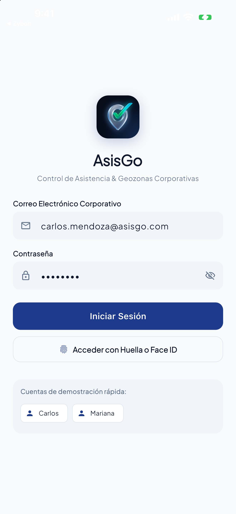 | 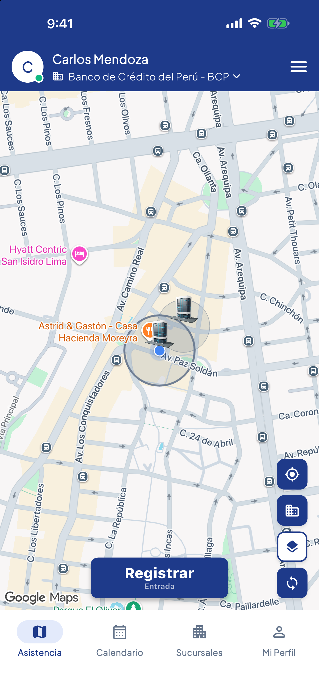 | 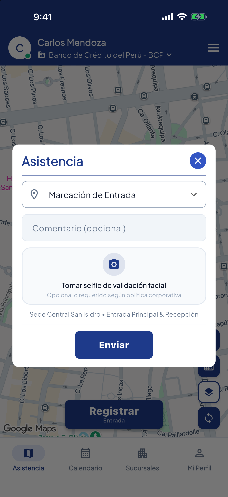 |

| Empresas y sedes | Calendario y auditoría | Perfil, horario y permisos |
| :---: | :---: | :---: |
| 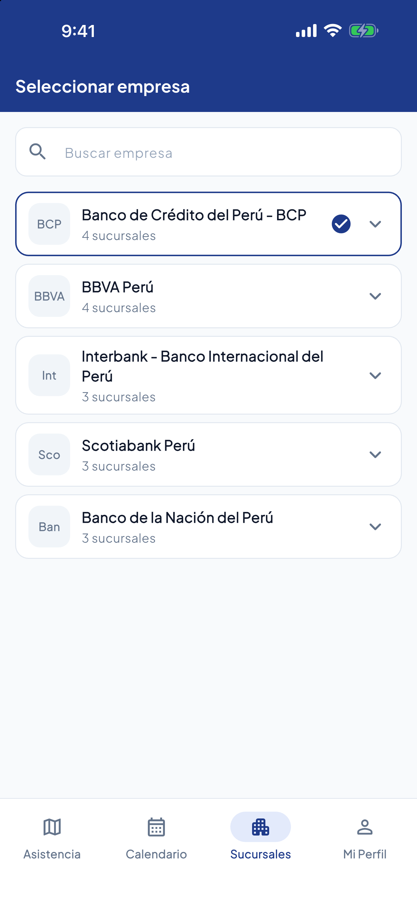 | 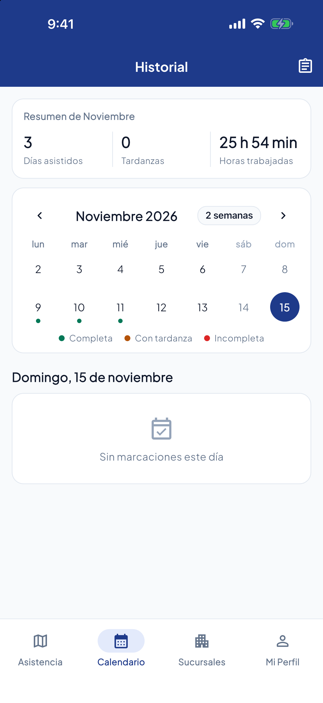 | 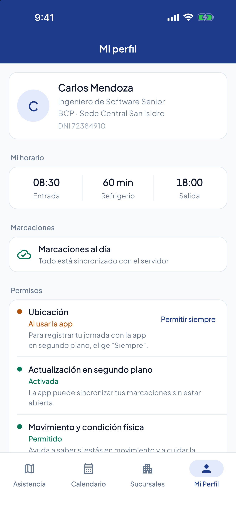 |

**Dynamic Island y Live Activity (iOS)**

| Dynamic Island expandida | Pantalla de bloqueo |
| :---: | :---: |
| 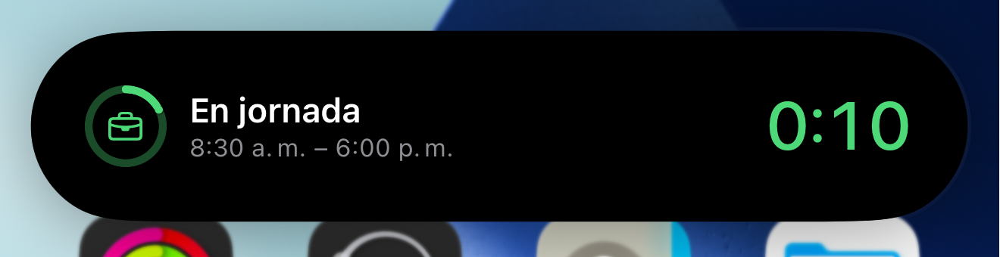 | 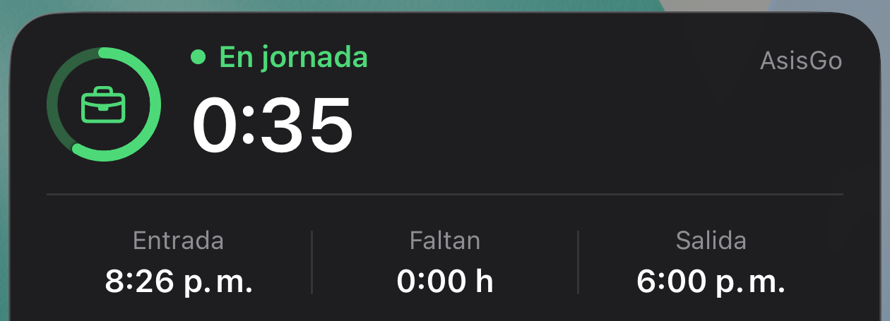 |

**Flujo de permisos tras iniciar sesión**

| Antes de empezar | Ubicación | Movimiento y actividad física | Ubicación «Siempre» |
| :---: | :---: | :---: | :---: |
| 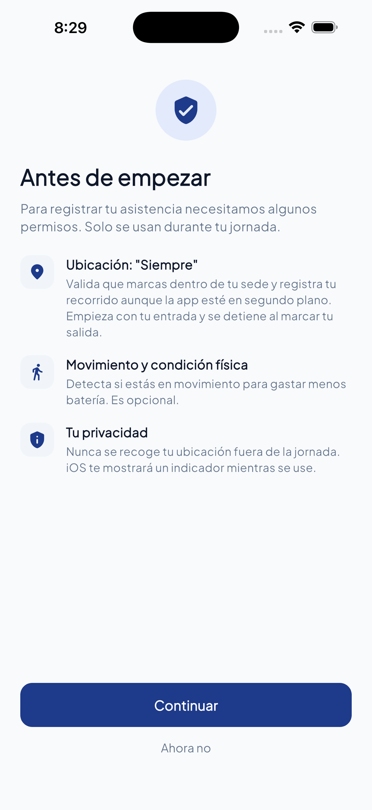 | 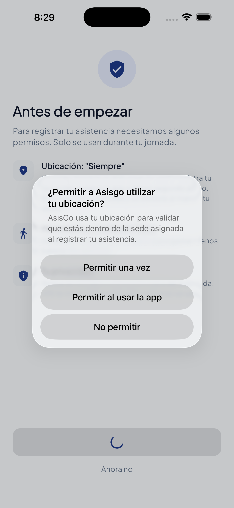 | 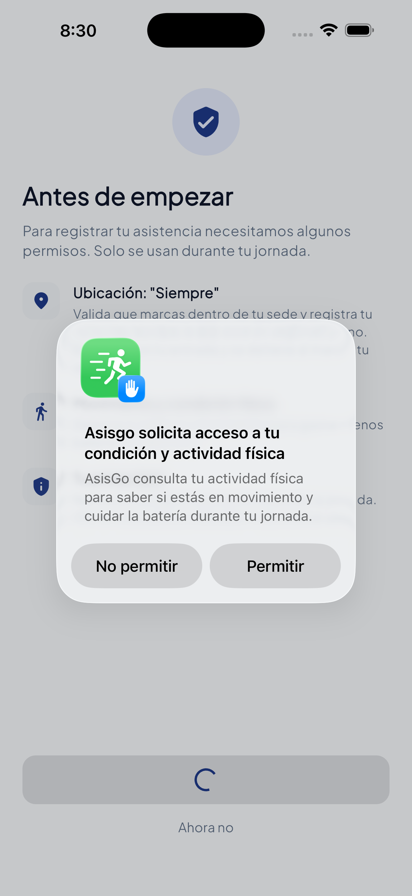 | 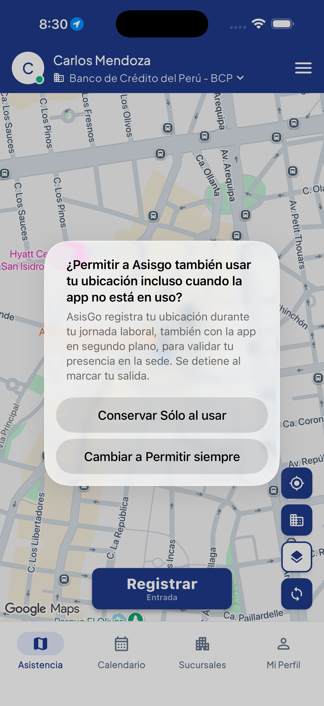 |

---

## Características

### Asistencia y mapa
- **Mapa de Google Maps** con geocercas y marcadores de las sedes, paleta azul corporativa y modo claro/oscuro.
- **Ciclo de jornada** como máquina de estados: entrada → inicio de refrigerio → fin de refrigerio → salida (o salida anticipada).
- **Marcación rápida:** validación de proximidad con la fórmula de Haversine, selfie frontal opcional o exigida por política y comentario opcional.
- **Jerarquía de tres niveles:** empresa → sucursal → geocerca (coordenadas y radio en metros). Al elegir una empresa o sede, el mapa muestra solo sus geocercas.

### Segundo plano y Live Activities
- **iOS:** Dynamic Island (compacta y expandida) y tarjeta en la pantalla de bloqueo con cronómetro de la jornada, hora de entrada, tiempo restante y hora de salida. Implementada con [`live_island_kit`](https://pub.dev/packages/live_island_kit) y una extensión WidgetKit propia.
- **Android:** notificación persistente con `RemoteViews` y `<Chronometer>` nativo, y botón para volver a la app.
- **Seguimiento en segundo plano:** el recorrido se registra durante la jornada, empieza con la entrada y se detiene al marcar la salida.

### Permisos con explicación previa
Tras iniciar sesión, la app explica para qué usa cada permiso antes de pedirlo: ubicación («Siempre»), movimiento y condición física (opcional) y privacidad. El estado de cada permiso se puede revisar desde **Mi Perfil**.

### Modo sin conexión
- Las marcaciones se guardan en una cola local con estado pendiente (`isSynced = false`).
- Al recuperar la conexión se sincronizan automáticamente.
- En **Mi Perfil** hay un botón para sincronizar manualmente y ver el estado de las marcas.

### Sesión perenne
La sesión no expira por inactividad, de modo que el colaborador puede marcar al instante. Al cerrar la app o enviarla a segundo plano, la Live Activity (iOS) y la notificación (Android) siguen activas durante toda la jornada.

### Historial y justificaciones
- Calendario con resumen mensual (días asistidos, tardanzas y horas trabajadas) y estado por día: completa, con tardanza o incompleta.
- Justificaciones de incidencias con categorías (permiso médico, cita médica, falla técnica, falta injustificada, comisión de servicios y asuntos particulares), selector de fecha y adjuntos (JPG, PNG y PDF) con visor integrado.

### Seguridad
- Detección de proveedores de ubicación simulados y de precisión anómala; las marcaciones se bloquean si se detecta suplantación.
- La protección está activa por defecto y puede desactivarse solo en desarrollo (ver [Opciones de compilación](#opciones-de-compilación)).

---

## Arquitectura

Clean Architecture por funcionalidad, con estado gestionado con **BLoC / Cubit**.

```
lib/
├── app/                          # Navegación principal (shell con pestañas)
├── core/
│   ├── config/                   # Flags de compilación (anti Fake GPS)
│   ├── constants/                # Colores y constantes
│   ├── contracts/                # Interfaces de repositorios y servicios
│   ├── security/                 # Detección de ubicación simulada, temporizador de sesión
│   ├── services/                 # Ubicación, permisos, notificaciones, Live Activity,
│   │                             # conectividad, sincronización offline, almacenamiento
│   ├── theme/                    # Tema claro/oscuro y paleta
│   ├── tracking/                 # Seguimiento de ubicación en segundo plano
│   ├── utils/                    # Formato de fechas
│   └── widgets/                  # Botones, tarjetas, diálogos, skeletons y shimmer
└── features/
    ├── attendance_map/           # Mapa, marcación, sedes y empresas
    ├── auth/                     # Login (credenciales y biometría)
    ├── calendar_history/         # Calendario e historial
    ├── justifications/           # Justificaciones e incidencias
    ├── permissions/              # Pantalla «Antes de empezar»
    └── profile/                  # Perfil, horario y estado de permisos
```

Cada funcionalidad se divide en `data/`, `domain/` y `presentation/` (`cubit/`, `views/`, `widgets/`).

---

## Extensiones nativas

### iOS — `ios/LiveIslandExtension/`
Extensión WidgetKit/ActivityKit generada con `live_island_kit`:
- `Widget/LiveIslandWidget.swift`: diseño SwiftUI de la Dynamic Island y de la pantalla de bloqueo. Lee los valores que envía `lib/core/services/live_activity_service.dart`.
- `Shared/` y `Renderer/`: atributos de la actividad, almacenamiento compartido y renderizado.
- Requiere un **App Group** (`group.com.asisgo.app.asisgo`).

> No vuelvas a ejecutar `dart run live_island_kit:setup` sin respaldar `LiveIslandWidget.swift`: lo reescribe y se pierde el diseño propio.

### Android — `android/app/src/main/`
- `kotlin/com/asisgo/app/asisgo/MainActivity.kt`: canal de plataforma que construye la notificación en vivo.
- `res/layout/notification_island_expanded.xml` y `notification_island_collapsed.xml`: vistas expandida y colapsada con cronómetro nativo.

---

## Requisitos

- **Flutter** estable con **Dart ≥ 3.7.2**.
- **iOS 16.1+** (necesario para Live Activities y Dynamic Island). Requiere macOS y Xcode.
- **Android 8.0 (API 26)** o superior.
- Una **clave de Google Maps** para iOS y Android.

---

## Instalación y ejecución

```bash
git clone https://github.com/VMichael1999/AsisGo.git
cd AsisGo
flutter pub get
```

Configura la clave de Google Maps:
- **Android:** se lee del *placeholder* `GOOGLE_MAPS_API_KEY` en `android/app/src/main/AndroidManifest.xml`.
- **iOS:** se registra en `ios/Runner/AppDelegate.swift` (`GMSServices.provideAPIKey`).

Luego ejecuta en un dispositivo o simulador:

```bash
flutter run
```

### Dynamic Island en el simulador de iOS
`flutter run` y `flutter build ios --simulator` no incrustan el App Group, y sin él la Dynamic Island no arranca. Para verla en el simulador, compila con `xcodebuild`:

```bash
flutter build ios --simulator --debug --config-only --dart-define=STRICT_MOCK_PROTECTION=false

xcodebuild -workspace ios/Runner.xcworkspace -scheme Runner -configuration Debug \
  -sdk iphonesimulator -destination 'generic/platform=iOS Simulator' \
  -derivedDataPath build/ios_sim_dd \
  CODE_SIGN_IDENTITY="-" CODE_SIGNING_ALLOWED=YES CODE_SIGNING_REQUIRED=NO DEVELOPMENT_TEAM="" build

xcrun simctl install booted build/ios_sim_dd/Build/Products/Debug-iphonesimulator/Runner.app
xcrun simctl launch booted com.asisgo.app.asisgo
```

### Opciones de compilación

| Opción | Valor por defecto | Uso |
| :--- | :---: | :--- |
| `--dart-define=STRICT_MOCK_PROTECTION=false` | `true` | Desactiva la protección contra Fake GPS. Solo para desarrollo o simulador, donde la ubicación es simulada. |

---

## Pruebas y análisis

```bash
dart analyze
flutter test
```

Las pruebas cubren el cubit de asistencia, el resumen por día, el seguimiento en segundo plano, la sincronización offline, el servicio de seguridad, las justificaciones, el diseño de la Live Activity y la respuesta háptica.

---

## Cuentas de demostración

La pantalla de inicio de sesión incluye accesos rápidos a estos usuarios. En modo demostración **la contraseña no se valida**.

| Correo | Cargo | Horario |
| :--- | :--- | :---: |
| `carlos.mendoza@asisgo.com` | Ingeniero de Software Senior | 08:30 – 18:00 |
| `mariana.ruiz@asisgo.com` | Especialista de RRHH y Talento | 09:00 – 18:30 |

---

## Licencia

Uso corporativo confidencial. Todos los derechos reservados.
